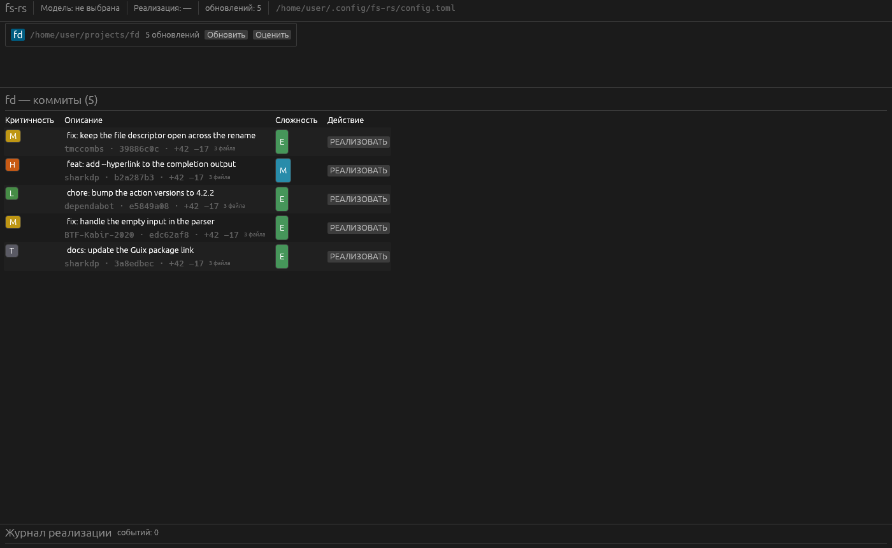
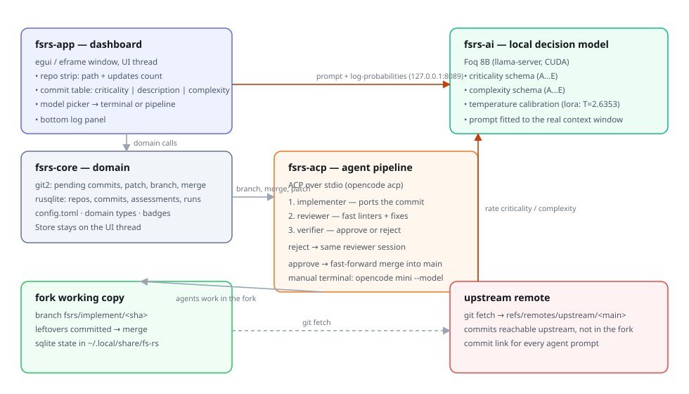
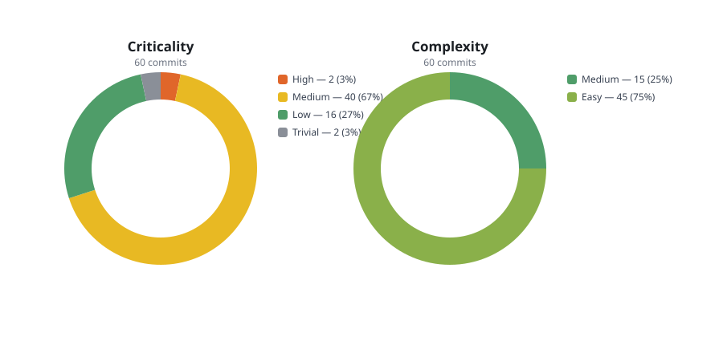

# fs-rs

[](https://www.rust-lang.org/)
[](https://github.com/Githab-capibara/fs-rs/actions/workflows/ci.yml)
[](deny.toml)
[](LICENSE)
[](https://github.com/Githab-capibara/fs-rs)
[](https://opencode.ai/)
[-green?style=flat-square)](https://github.com/yohanargentina-oss/Foq)

**Desktop dashboard that tracks the upstream commits a fork is missing, rates
them with a local model, and ports them into the fork with a three-agent
pipeline.**



`fs-rs` is a standalone Rust application. It watches one or more forks of
upstream projects, shows every upstream commit that the fork does not have
yet, judges how critical and how complex each of them is, and — when the user
asks for it — ports the commit into the fork with an implementation agent, a
reviewer that runs the linters and a verifier that approves or rejects the
result.

Nothing leaves the machine: the ratings come from a local model, and the
agents are the ones that the user has already configured in OpenCode.

---

## Contents

| Guide | Purpose |
|-------|---------|
| [Getting started](docs/guides/01-getting-started.md) | Run the dashboard for the first time |
| [Configuration](docs/guides/02-configuration.md) | Every key of `config.toml` |
| [The local decision model](docs/guides/03-local-decision-model.md) | Install and run the Foq runtime |
| [Documentation](docs/README.md) | The decisions, the design notes and the benchmarks |

---

## What it does

### One strip, one table, one terminal

The window has four areas: a header, a horizontal strip with the tracked
repositories and the number of pending updates of each, the table of the
missing commits, and a real terminal on the right.

The table has three columns: the **criticality** on the left, the description
in the middle, the **complexity** on the right, and `РЕАЛИЗОВАТЬ` at the end
of the row.



### Ratings from a local model

Every commit is rated by [Foq](https://github.com/yohanargentina-oss/Foq), an
open-source decision model that runs on the GPU of the machine. Two schemas,
`criticality` and `complexity`, five lettered answers each. The
log-probabilities of the letters are calibrated with temperature scaling, so
the ratings can be compared between commits.

The model does nothing else. It never writes code and never talks to the
agents.

### One click to port a commit

`РЕАЛИЗОВАТЬ` creates the branch `fsrs/implement/<short-sha>` and runs the
pipeline:

1. the **implementer** ports the upstream change,
2. the **reviewer** runs the fast linters — `cargo fmt --check`,
   `cargo clippy -- -D warnings`, `cargo test`, `shellcheck`, `oxlint`,
   `typos` — and fixes everything they report,
3. the **verifier** judges the result and approves or rejects it.

A rejection sends the feedback back to the *same* reviewer session, so the
reviewer keeps the context of its work. Only an approval merges the branch
into `main`, and the merge is a fast-forward.

Every agent is driven through the [Agent Client Protocol](https://agentclientprotocol.com),
so the pipeline survives a change of the agent and the sessions survive the
rework loop.

### A manual terminal

Clicking a commit opens a terminal that runs `opencode mini --model <model>`
with the model that the user picked from the models that OpenCode has
registered. It is a real pseudo terminal, not a log view.

---

## The measured numbers

60 real upstream commits of `sharkdp/fd`, rated by the local model on a
Quadro M4000M:



| Metric | Value |
|--------|-------|
| Commits rated | 60, **0 failures** |
| Latency p50 / p95 | 8.9 s / 26.6 s |
| Criticality | 2 High · 40 Medium · 16 Low · 2 Trivial |
| Complexity | 15 Medium · 45 Easy |
| Confidence (median) | 0.46 criticality · 0.48 complexity |

The full report, with every commit, is in the
[benchmark report](docs/benchmarks/README.md).

---

## Build

Rust 1.88 or newer, and **zig 0.15.2**: the terminal panel renders its output
with the Ghostty VT engine, and `libghostty-vt-sys` builds that engine with
`zig build`. Without it the workspace does not compile — the runner of the CI
installs zig for exactly this reason.

```bash
cargo build --release
cargo run -p fsrs-app
```

The build is offline-friendly once the dependencies are cached:

```bash
cargo build --release --offline
```

## Test

```bash
cargo test --workspace --offline
```

The suite covers the domain, the git layer, the store, the prompt of the
model, the calibration, the ACP client against a mock agent, and the window
itself through `egui_kittest`. The tests that need a running agent or a
running model skip themselves when it is absent.

| Suite | What it covers |
|-------|----------------|
| `crates/fsrs-core/tests` | The git layer and the catalogue against real repositories |
| `crates/fsrs-ai/tests` | The conformance of the prompt, the calibration, the live server |
| `crates/fsrs-acp/tests` | The pipeline against the mock agent, the live OpenCode agent |
| `crates/fsrs-app/tests/gui.rs` | The window: the strip, the table, the picker, the pipeline |

## Continuous integration

[`.github/workflows/ci.yml`](.github/workflows/ci.yml) runs on every push and
every pull request:

| Job | What it runs |
|-----|--------------|
| Rustfmt | `cargo fmt --all --check` |
| Clippy | `cargo clippy --workspace --all-targets -- -D warnings` |
| Tests | `cargo test --workspace` |
| Documentation | `python3 scripts/verify-docs.py` |
| cargo-deny | [`deny.toml`](deny.toml): the licences, the advisories, the duplicate versions and the sources of the dependency tree |

The jobs that compile the workspace install zig 0.15.2 first: the terminal
panel renders its output with the Ghostty VT engine, which
`libghostty-vt-sys` builds with `zig build`.

The allow list of `deny.toml` is audited against `cargo metadata`: copyleft
and unlicensed crates fail the build. The three `unmaintained` advisories of
the D-Bus stack of the accessibility layer are ignored with a documented
reason — they arrive transitively through `eframe` and are notices, not
vulnerabilities.

## Screenshot

The picture above is the real window, rendered by the real code:

```bash
cargo run -p fsrs-app --example screenshot -- docs/images/hero.png
```

## Verify the documentation

Every number, every default and every link of this documentation is checked
against the code:

```bash
python3 scripts/verify-docs.py
```

## Architecture

| Crate | Content |
|-------|---------|
| [`fsrs-core`](crates/fsrs-core) | The domain: repositories, upstream commits, ratings, runs, the store, the git operations |
| [`fsrs-ai`](crates/fsrs-ai) | The client of the local Foq model: the schemas, the prompt, the calibration, the accelerators |
| [`fsrs-acp`](crates/fsrs-acp) | The ACP client, the prompts of the three agents, the pipeline, the mock agent |
| [`fsrs-app`](crates/fsrs-app) | The egui window, the background worker, the terminal panel |

The decisions behind them are recorded in the
[architecture decision records](docs/adr/README.md):

| ADR | Title |
|-----|-------|
| [ADR-01](docs/adr/ADR-01-horizontal-repository-strip.md) | Show the repositories in a horizontal strip |
| [ADR-02](docs/adr/ADR-02-opencode-mini-for-the-manual-terminal.md) | Run `opencode mini` in the manual terminal |
| [ADR-03](docs/adr/ADR-03-agents-only-through-acp.md) | Drive the agents only through the Agent Client Protocol |
| [ADR-04](docs/adr/ADR-04-mock-agent-as-a-test-double.md) | Keep the mock agent in the library |
| [ADR-05](docs/adr/ADR-05-foq-as-the-only-local-model.md) | Use Foq as the only local decision model |
| [ADR-06](docs/adr/ADR-06-context-fitted-prompts.md) | Fit every prompt into the window of the runtime |

## License

MIT. See [LICENSE](LICENSE).
