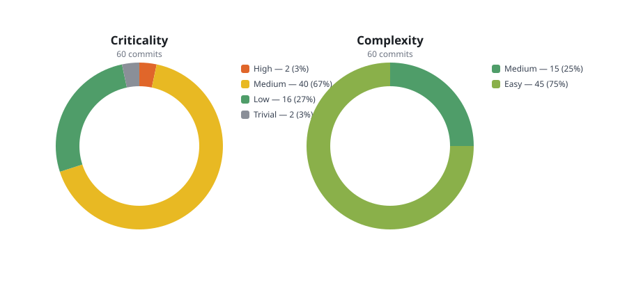

# Benchmark of the local decision model

The numbers below come from a real run of the local model against the upstream
of a real project. The raw report is [`decision-model.json`](decision-model.json).

## The run

| Parameter | Value |
|-----------|-------|
| Repository | `sharkdp/fd`, shallow clone, 1451 commits |
| Revision | `HEAD` |
| Commits rated | 60, newest first |
| Model | `foq` — Foq 8B with the decision adapter, CUDA on the Quadro M4000M |
| Window | 4096 tokens, one slot |
| Failures | 0 |

```bash
cargo run -p fsrs-ai --example benchmark -- <repository> HEAD 60 \
    > docs/benchmarks/decision-model.json
```

## The distribution



| Criticality | Commits | Share |
|-------------|---------|-------|
| High | 2 | 3% |
| Medium | 40 | 67% |
| Low | 16 | 27% |
| Trivial | 2 | 3% |

| Complexity | Commits | Share |
|------------|---------|-------|
| Medium | 15 | 25% |
| Easy | 45 | 75% |

The 60 newest commits of `fd` are release commits, merges of pull requests and
dependabot updates. The model puts almost all of them in the middle of the
scale, which matches the work: a release or a dependency bump is not trivial,
but it is rarely a rupture of the project.

## The latency

Every rating is two requests — one for the criticality, one for the complexity
— on a Quadro M4000M with a quantised 8B model.

| Percentile | Time |
|------------|------|
| Minimum | 4.9 s |
| p50 | 8.9 s |
| Mean | 11.5 s |
| p95 | 26.6 s |
| Maximum | 34.9 s |

The spread is the size of the diff: a small commit is rated in a few seconds,
a large one takes half a minute, because the whole diff has to be read by the
model.

The dashboard keeps at most two ratings in flight, because the model is a
single process on a single GPU. The 60 commits of this run would therefore
take about six minutes in the dashboard.

## The confidence

| Metric | Minimum | Median | Maximum |
|--------|---------|--------|---------|
| Criticality | 0.301 | 0.464 | 0.739 |
| Complexity | 0.317 | 0.478 | 0.739 |

**No rating reached the default threshold of 0.8.** Every one of the 60
commits was flagged `needs_review`.

This is the expected behaviour of a calibrated model, not a defect: the
temperature of the `lora` profile (2.6353) flattens the distribution, so the
model rarely claims to be certain. The practical consequence is that the
ratings are an **ordering** of the work, not a decision about it. A commit that
the model rated `Medium` deserves to be looked at before one that it rated
`Low`, and the human still decides.

The threshold is configurable:

```toml
min_confidence = 0.45
```

With that value, roughly half of the ratings of this run would be accepted
without a review.

# Benchmark of the binary

The size of the program is a measurement like any other: a dashboard that
grows by a megabyte after every change is a dashboard nobody wants to
start. The numbers come from `cargo-bloat`:

```bash
cargo bloat --release --crates --bin fsrs -p fsrs-app
```

## The size

| Measurement | Value |
|-------------|-------|
| The file | 26.5 MiB |
| The section of the code | 10.9 MiB |
| The crates in it | 154 |

The biggest parts of the code are the ones the dashboard cannot do without:
the window (`egui`, `winit`, `epaint`), the protocol of the agents
(`agent_client_protocol`), the fonts (`read_fonts`, `skrifa`) and the
terminal (`libghostty_vt_sys`). The code of the dashboard itself is small:
137.7 KiB, one and a half percent of the binary.

## The profile-guided optimisation

The build with a profile measures the program while it runs and lets the
compiler lay the hot paths out first:

```bash
FSRS_PGO_COMMAND='./target/pgo/train/release/fsrs --help' \
    scripts/build-pgo.sh
```

The tool that merges the profiles has to be the one of the same toolchain as
the compiler — the format of the raw profiles changes between the versions:

```bash
rustup component add llvm-tools-preview
```

| Measurement | The ordinary build | The build with a profile |
|--------------|--------------------|--------------------------|
| The file | 26.5 MiB | 23.6 MiB (−11%) |
| The section of the code | 10.9 MiB | 9.9 MiB (−9%) |
| The start of the program | 5.0 ms | 4.1 ms (−18%) |

The profile is gathered by running the program, so the numbers depend on the
workload: the profile of a run that only reads the configuration is not the
profile of a run that rates a commit.

## What the run proves

* Every commit was rated — 0 failures. Before
  [ADR-06](../adr/ADR-06-context-fitted-prompts.md), the fifth commit
  aborted the whole run with `http status: 400`.
* A commit that the model refuses to rate no longer stops the run: the
  benchmark records the failure in the report and continues.
* The context of the commit is shortened instead of the prompt being rejected:
  the longest prompt of the run still fitted into the window.

## Reproducing

```bash
git clone --depth 400 https://github.com/sharkdp/fd.git /tmp/bench-upstream
cargo run -p fsrs-ai --example benchmark -- /tmp/bench-upstream HEAD 60 \
    > docs/benchmarks/decision-model.json
```

The absolute numbers depend on the accelerator and on the state of the model
in the cache. The distribution and the shape of the latency are the parts that
matter.

# Benchmark of the synchronisation of a fork

The second measurement is the work the dashboard does before the model is
asked anything: fetching the upstream branch of a fork, listing the commits the
fork is missing, and storing that list. The numbers come from Criterion over
the benchmark in
[`crates/fsrs-core/benches/sync.rs`](../../crates/fsrs-core/benches/sync.rs).

```bash
cargo bench -p fsrs-core
```

## The fixture

An upstream of 1500 real commits, cloned in full, then reset 200 commits back
— the backlog a user comes back to after a while. The commits each change one
small file, so every diff is real.

## The numbers

| Operation | Path | Time |
|-----------|------|------|
| Listing 200 pending commits | the previous path: a diff per commit | 33.99 ms |
| Listing 200 pending commits | statistics known, no diff computed | 2.99 ms |
| Listing 200 pending commits | the first listing, nothing known | 34.89 ms |
| Storing 500 rows | the previous path: delete all, insert all | 1.14 ms |
| Storing 500 rows | upsert, every row changed | 0.428 ms |
| Storing 500 rows | upsert, the list did not move | 0.173 ms |
| Synchronisation end to end | cold, statistics unknown | 41.28 ms |
| Synchronisation end to end | warm, statistics known | 4.96 ms |

The warm synchronisation is **8.3x faster** than the cold one and **6.8x
faster** than the previous path, because the only thing that is computed is
what changed. The list is stored only when it actually differs from what is
already on disk.

## Why a commit is not measured twice

The fork is synchronised every time the dashboard opens. Between two
synchronisations of a fork that did not move, nothing about its pending commits
changes — a commit is immutable — so the diff statistics of the first listing
are kept in the repository itself, and reused on every later one. See
[ADR-09](../adr/ADR-09-commits-are-counted-once.md).

# Benchmark of the calls to the decision server

The third measurement is the traffic between the dashboard and the local
model. Every call is a round trip over the loopback, and the local model
answers in seconds — so a call that is not needed is a call the user waits
for.

The numbers come from the live server, with the counter of the client:

```bash
cargo test -p fsrs-ai --test live_server
```

## The calls of one rating

| Question | The previous path | The current path |
|----------|-------------------|------------------|
| The criticality of a commit | 1 `/completion` + 1 `/props` + the count of the tokens | 1 `/completion` |
| The complexity of the same commit | 1 `/completion` + 1 `/props` + the count of the tokens | 1 `/completion` |
| The whole rating | 6 calls | 4 calls |

The client is shared by every rating of the dashboard, so the size of the
window is asked once per process and not once per commit. The fitted context
is remembered too, so the second question of a commit — the complexity after
the criticality — reads the same context without asking the server to count
the tokens again.

## The series of commits

| Measurement | The previous path | The current path |
|-------------|-------------------|------------------|
| Three commits, small diffs | 12 calls, 12.4 s | 10 calls, 9.4 s |
| The window of the server | asked once per commit | asked once per process |

The series is the case that matters: the dashboard rates the backlog of a
fork commit after commit, and every commit used to pay for a handshake and a
fresh question about the window of the server.

## The fitting of a prompt

The fitting is what asks the server how many tokens a prompt holds. The
binary search asked the server once per step; the estimate asks it once for
the whole context and a few times to correct the cut. The numbers come from
Criterion over the benchmark in
[`crates/fsrs-ai/benches/context.rs`](../../crates/fsrs-ai/benches/context.rs),
with a window of 1024 tokens — a context of six thousand characters has to be
cut, which is the case where the two algorithms differ:

```bash
cargo bench -p fsrs-ai --bench context
```

| Algorithm | Calls to the server | Time |
|-----------|---------------------|------|
| The binary search | 14 | 48.5 µs |
| The estimate and the correction | 10 | 36.8 µs |

The times are of the algorithm alone, with a local tokenizer: the calls
themselves are measured against the live server, and they are the part that
costs seconds.
