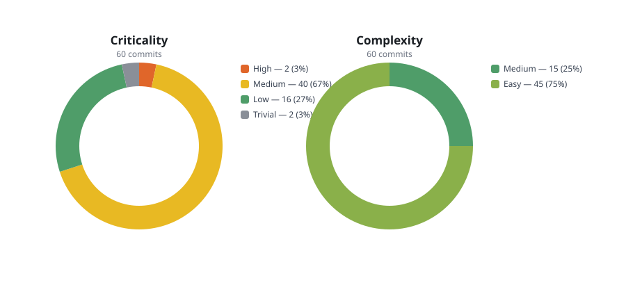

# Benchmark of the local decision model

The numbers below come from a real run of the local model against the upstream
of a real project. The raw report is [`decision-model.json`](decision-model.json).

## The run

| Parameter | Value |
|-----------|-------|
| Repository | `sharkdp/fd`, shallow clone, 1451 commits |
| Revision | `HEAD` |
| Commits rated | 60, newest first |
| Model | `foq` — Foq 8B with the decision adapter, CUDA on the Quadro M4000M |
| Window | 4096 tokens, one slot |
| Failures | 0 |

```bash
cargo run -p fsrs-ai --example benchmark -- <repository> HEAD 60 \
    > docs/benchmarks/decision-model.json
```

## The distribution



| Criticality | Commits | Share |
|-------------|---------|-------|
| High | 2 | 3% |
| Medium | 40 | 67% |
| Low | 16 | 27% |
| Trivial | 2 | 3% |

| Complexity | Commits | Share |
|------------|---------|-------|
| Medium | 15 | 25% |
| Easy | 45 | 75% |

The 60 newest commits of `fd` are release commits, merges of pull requests and
dependabot updates. The model puts almost all of them in the middle of the
scale, which matches the work: a release or a dependency bump is not trivial,
but it is rarely a rupture of the project.

## The latency

Every rating is two requests — one for the criticality, one for the complexity
— on a Quadro M4000M with a quantised 8B model.

| Percentile | Time |
|------------|------|
| Minimum | 4.9 s |
| p50 | 8.9 s |
| Mean | 11.5 s |
| p95 | 26.6 s |
| Maximum | 34.9 s |

The spread is the size of the diff: a small commit is rated in a few seconds,
a large one takes half a minute, because the whole diff has to be read by the
model.

The dashboard keeps at most two ratings in flight, because the model is a
single process on a single GPU. The 60 commits of this run would therefore
take about six minutes in the dashboard.

## The confidence

| Metric | Minimum | Median | Maximum |
|--------|---------|--------|---------|
| Criticality | 0.301 | 0.464 | 0.739 |
| Complexity | 0.317 | 0.478 | 0.739 |

**No rating reached the default threshold of 0.8.** Every one of the 60
commits was flagged `needs_review`.

This is the expected behaviour of a calibrated model, not a defect: the
temperature of the `lora` profile (2.6353) flattens the distribution, so the
model rarely claims to be certain. The practical consequence is that the
ratings are an **ordering** of the work, not a decision about it. A commit that
the model rated `Medium` deserves to be looked at before one that it rated
`Low`, and the human still decides.

The threshold is configurable:

```toml
min_confidence = 0.45
```

With that value, roughly half of the ratings of this run would be accepted
without a review.

## What the run proves

* Every commit was rated — 0 failures. Before
  [ADR-06](../adr/ADR-06-context-fitted-prompts.md), the fifth commit
  aborted the whole run with `http status: 400`.
* A commit that the model refuses to rate no longer stops the run: the
  benchmark records the failure in the report and continues.
* The context of the commit is shortened instead of the prompt being rejected:
  the longest prompt of the run still fitted into the window.

## Reproducing

```bash
git clone --depth 400 https://github.com/sharkdp/fd.git /tmp/bench-upstream
cargo run -p fsrs-ai --example benchmark -- /tmp/bench-upstream HEAD 60 \
    > docs/benchmarks/decision-model.json
```

The absolute numbers depend on the accelerator and on the state of the model
in the cache. The distribution and the shape of the latency are the parts that
matter.
